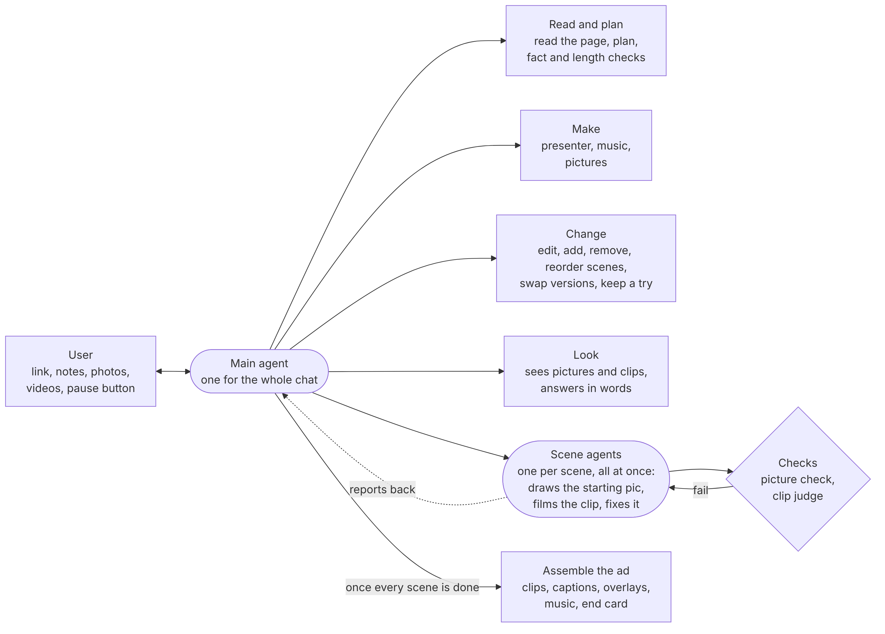

# AdForge

A chat agent that turns a product page into a short video ad. You just send the product link and it makes the whole ad: a presenter talks about the product, and product shots show it being used. If a scene comes out wrong, you write a note in the chat and the agent fixes it.

- **The ads, a month ago and now:** _link coming_
- **Loom walkthrough:** [_link ](https://www.loom.com/share/e71fc00b292e4eda901238046fbb9be5)
- 


## Words I use

- **Video model:** the AI that films each clip. It's Boreal-H3, Creatify's model (H3 for short).
- **Product shot:** a clip of the product being used, with the presenter's voice over it.
- **Main agent:** the one agent the user chats with.
- **Scene agent:** one agent per scene. It draws the starting pic, films the clip and fixes it.
- **Starting pic and end pic:** pictures drawn before filming. The clip starts on the starting pic and ends exactly on the end pic.
- **Clip judge:** an AI that watches each clip and passes or fails it.

## How it works

<picture>
  <source media="(prefers-color-scheme: dark)" srcset="docs/readme/how-it-works-dark.png">
  
</picture>

<!-- The diagram is a picture so its labels show whole on every screen. Source: docs/readme/how-it-works.mmd; render it with Mermaid in light and dark and replace both PNGs. -->

Why each part is like this:

| Part | Why |
|---|---|
| Main agent | [Two calls that shaped the agents](docs/why/architecture.md): what forced them and what they cost me |
| Read and plan | [Reading the page](docs/why/read-the-page.md): an ad once said another product's facts |
| Scene agent | [Working around the video model](docs/why/video-model.md): starting pics, end pics, one movement per clip |
| Checks | [Getting the clip judge to agree with me](docs/why/clip-judge.md): what it should fail |

Every part, with its code: [docs/how-it-works.md](docs/how-it-works.md).

## The hard parts

### 1. Working around the video model

AI video still breaks physics a lot. That's normal right now, so most of my work went into finding what the video model gets wrong and building around it.

The biggest one: at first I sent the real product photos to the video model. It copied everything in them, backgrounds, clothes, even other people, and only half the product shots worked. So now the agent draws a starting pic for every clip and gets it checked first. I think if the starting pic and the instructions are right, it's really hard for the video model to break physics. 26 of 27 product shots worked after that. But if the starting pic is wrong the whole clip goes wrong, so it always gets checked.

The rest (end pics, one movement per clip, contents never changing on screen, the whole product in the starting pic): [docs/why/video-model.md](docs/why/video-model.md). All 21 quirks I found: [docs/h3-limits.md](docs/h3-limits.md).

### 2. Getting an AI to judge video like I do

I use an AI judge in two places. In the app, it watches every clip and fails the broken ones. For testing, I kept trying to build one that grades every test ad, so I only watch what it flags.

Both hit the same wall. Judging video is mostly taste, and I still can't get an AI to agree with me. In my last test, the test judge caught only 3 of the 11 broken clips I found.

So in the app the judge is lenient. It fails only what it can catch reliably, and the user fixes the rest with a note. That works most of the time ([numbers](#numbers)). For testing, my own eyes plus my saved grades are faster and better right now. More: [docs/why/clip-judge.md](docs/why/clip-judge.md), [docs/why/evals.md](docs/why/evals.md).

### 3. One agent per scene, not one agent for everything

The first prompt for every product shot used to be written by a model that never saw a picture, just a label and one sentence. But one agent seeing every scene's pictures would flood its memory. So each scene gets its own agent now. It picks its own photos, draws the starting pic, films the clip and fixes it, and the main agent only gets words back.

The cost is scenes can drift, like a 2 oz bottle in one scene and the 8 oz in the next. A single agent like Creatify's keeps scenes consistent. For now I lock the product, its size and shared props in the plan. More: [docs/why/architecture.md](docs/why/architecture.md#2-one-agent-per-scene-instead-of-one-agent-for-everything).

## Numbers

I built it in 2 months: 1,748 commits, and [15 batches of test ads](docs/test-rounds/README.md) I graded myself, with every failure and its fix.

My last test was Nov 17: 30 ads, 15 on products I'd tested before and 15 on products the app had never seen.

- **Whole ads:** 21 of 30 worked. One bad clip fails the whole ad.
- **Clips:** 105 of 116 clips in the finished ads worked.
- **Fixing with a note:** one note fixed 16 of 22 bad scenes ([tests](docs/test-rounds/scene-tests.md#owner-note-eval-nov-17-ads)).

AI video still breaks sometimes, so the app is built around fixing it with a note.

"Worked" means I watched it and nothing broke: no wrong claim, no impossible motion, no made-up product part. It doesn't mean the ad would sell, I didn't grade that.

## What it still can't do

- **End pics.** They mostly work, but sometimes they create faults. The video model always tries to end exactly on the end pic, so if the end pic is wrong, or doesn't match what the prompt asks, the clip goes wrong. And even when the agent asks for the right thing, the picture model sometimes draws the wrong thing. About 3 to 6 of 24 failed clips across 4 runs trace back to them. I can definitely fix this, but I chose not to right now, because most of the time they're doing more good than harm.
- **Logos and labels.** Wrong letters are fine to me. But sometimes a logo comes and goes, in a different colour and place from the real one (a Stanley cup ad).
- **Still shots.** We still haven't figured out how to do still shots properly. When there's nothing to move, the video model moves something by itself, like a drawer or a sprayer.

## What I'd work on next

- **Make the ads pull.** Right now they work, but they need to sell too. This needs domain knowledge.
- **New products, new failures.** Test the agent on new products, find the new ways it fails and fix them. This is still quite manual.
- **How far the agents can go.** The app can do more than make an ad and fix it with notes. I didn't test the rest, because making ads and fixing them with notes is the scope right now ([#549](https://github.com/Julian-Win-Stack/adforge/issues/549)).

## How to run

You need Docker.

```sh
cp .env.example .env      # fill in the keys
docker compose up
```

The app opens at http://localhost:5173 (backend on port 8000).

Keys, by env var name (what each is for is in `.env.example`):

- `OPENAI_API_KEY`: pictures, and every model call when Azure isn't set.
- `AZUREE_OPENAI_KEY` and `AZUREE_OPENAI_BASE_URL` (optional): run the text and vision models on Azure.
- `GEMINI_API_KEY`: watches page videos and videos the user sends. It isn't in `.env.example`; add it yourself.
- `FIRECRAWL_API_KEY` (page reading), `ELEVENLABS_API_KEY` (transcripts), `FAL_KEY` (music, picture hosting), `CREATIFY_API_ID` and `CREATIFY_API_KEY` (H3 clips).
- `LANGFUSE_PUBLIC_KEY` and `LANGFUSE_SECRET_KEY` (traces), `SENTRY_DSN` (optional, failure alerts).

Tests run on a scripted fake model and need no keys:

```sh
cd backend && uv run pytest -q -n auto --dist worksteal -m "not slow"   # fast run, ~30 s
cd backend && uv run pytest -q -n auto --dist worksteal                  # everything, as CI
cd frontend && npm test
```
