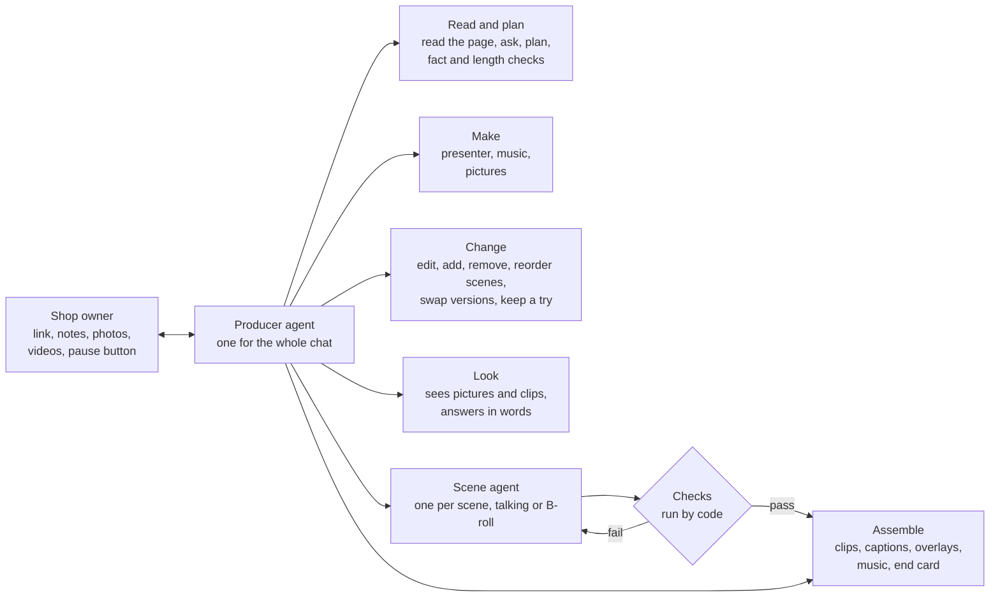

# AdForge

A chat agent that turns a product page into a short video ad. A presenter talks, B-roll shows the product being used, and the shop owner fixes any scene by writing a note.

Watch it work: https://www.loom.com/share/23d2f242ad414ea4ba889d0310d5a38d

See the ads and my grades: https://julian-win-stack.github.io/adforge-gallery/


## How it works

One agent, the producer, runs the whole chat, from the first product link to the last note. It is a model with tools: it calls one, reads the answer, and decides what to do next. There is no pipeline in code. The rules that matter live in the tools, which refuse with a reason ([ADR 1](docs/adr/0001-agent-loop-with-safety-in-the-tools.md), [ADR 10](docs/adr/0010-one-agent-after-the-first-clip.md)). Each scene is then made by its own scene agent ([ADR 11](docs/adr/0011-one-agent-per-broll-scene.md), [ADR 12](docs/adr/0012-every-scene-made-with-h3.md)).



The producer's 28 tools are in `backend/agents/producer.py` (`PRODUCER`); the scene agent's 10 are in `backend/agents/scene_agent/__init__.py` (`TOOLS`). What the parts do:

- **Reading the page.** Keeps only this product's text and photos. Page videos are watched whole on Gemini and cut into one-action moments for the ad's library. A page that can't be read can be pasted in the page panel. ([problem 2](#2-the-ad-stated-another-products-facts-so-i-rebuilt-the-page-reader))
- **Planning.** Before planning, the producer can ask the owner one round of questions; most go ahead with a stated default if unanswered (`backend/jobs/planning_questions.py`). The plan is 3 or 4 scenes by default: the first talking, the middle ones B-roll, at least one B-roll scene per ad. Each talking scene has its own style (selfie, propped, talking while using it) and product state (in its box, out of it, in use, beside its box), so no two in a row look the same (`backend/jobs/plan_rules.py`, [ADR 13](docs/adr/0013-more-broll-whole-clips.md)). One movement per B-roll clip. ([problem 3](#3-several-actions-in-one-clip-break-the-physics-so-one-clip-is-one-movement))
- **Planning checks.** Every line and what each scene shows is checked against the page, the owner and the photos, then against how long the clip can last. A failing line is rewritten up to twice; if it still fails, the producer fixes it with its scene tools (`producer.py:RunPlanningChecks`). Every fact comes from the page or the owner ([ADR 2](docs/adr/0002-facts-come-only-from-the-page-and-the-user.md)).
- **Scene agents.** The producer starts one agent per scene with an instruction (`start_scene_agent`). The agent picks the photos, draws a starting picture, films it with Boreal-H3 on Creatify, reads the checks and tries again. H3 speaks the checked line in the clip, in the presenter's voice words; no voice file is made. Only the producer talks to the owner.
- **Checks, run by code.** Every starting and end picture is checked before filming (`scene_agent/picture_check.py`). A planned move is checked before paying for a clip (`scene_agent/move_check.py`). Every clip, talking and B-roll, gets the clip judge and the word check (did H3 say the line?) inside the agent's `film` tool (`scene_agent/film.py:Film.run`). The agent can't skip them or overrule a verdict. A pass puts the clip in the ad. ([problem 1](#1-an-ad-cant-be-made-right-in-one-shot-so-one-agent-owns-the-scene))
- **Caps.** Per run: 6 starting pictures, 6 end pictures and 6 clips, with a few more after the scene changes (`scene_agent/lifecycle.py:MOST_TRIES`). When the agent gives up or hits the cap, the ad keeps its last try and the owner can swap in any other.
- **Look.** The producer can't see. It asks one question about a picture, clip or version, and a sub-call answers in words. It decides nothing (`backend/agents/look.py`).
- **Owner's notes.** The producer passes a note to the scene agent as its own instruction plus the owner's exact words, which code checks against the owner's messages (`backend/agents/owner_quotes.py`). Each note opens a new run, even while the agent is working. A photo sent with a note reaches that scene's agent (`backend/agents/note_photos.py`). On-screen words are changed with an overlay, for free, without filming again.
- **Presenter.** Made up from the page and the owner's wishes, or drawn from a photo the owner sends in the chat (`producer.py:RemakePerson`). Changing her voice films every scene again, so the producer quotes the cost and waits for a yes.
- **Versions.** Every try is kept. The producer or the owner can put any version back. A version whose voice or presenter changed since quotes its refilm cost first (`backend/agents/version_refilms.py`).
- **Make a copy.** A chat with nothing being made can be copied whole, rows and history included, so notes can be tried on the copy while the original stays as it was. Files are shared, not duplicated (`backend/chat/session_copy.py`).
- **Money and control.** No yes button before paid work, except a voice change or a refilm, which wait for the owner's yes to a quoted cost. The producer acts, then says what it cost. The pause button cancels steps not started yet; running ones finish, and a scene agent parks and later picks up where it stopped (`backend/agents/pause.py`).
- **What the app can't do.** The producer is told the app's limits (`docs/limitations.md`) and the video model's hard limits (`docs/h3-limits.md`), so it says "can't, because" and offers what can be done before any paid call.
- **Hard list.** Only four refusals live in code: another product's page mid-ad, a clip of an invented part before the owner approves its picture, a page's how-to photo sent to the picture model, and the video API's limits (`backend/agents/hard_list.py`).
- **Notices.** Every fallback or failure posts a notice written by code, not the producer. The owner sees only what they must act on; the rest goes to the developer record and Sentry (`backend/jobs/notices.py`). When an AI safety filter blocks a step the ad can't do without, the ad stops and says why.
- **Shared limits.** Calls to the picture model, Firecrawl and transcription wait in one line across workers, under each account's limits (`backend/gateway/service_limits.py`).
- **Assembly.** The clips play whole with their own sound, cut half a second after their last word (`backend/jobs/assembly.py`). Code draws captions from each clip's transcript, each scene's overlay and music under the voice, then the end card: product photo, name, one line from the page, price and website.

**Agentic in code, not yet in practice.** The producer's instructions give a usual order for a first ad, and tools refuse steps out of order, so a first ad nearly always runs the same way. The freedom shows mostly on the owner's notes.

**How the checks look.** The clip judge's product check is told to describe the product in its reference photos, then in each frame, before its verdict. Of the judge's questions, only that one fails a new clip; on a run the owner asked for, a "was the change made?" question can fail it too (`backend/jobs/clip_judge.py`). The word check fails a clip a viewer would hear saying something other than its line (`backend/jobs/word_check.py`). The picture check answers 4 pass-or-fail questions for a starting picture and 2 for an end picture, naming every wrong part.

## Hard problems

### 1. An ad can't be made right in one shot, so one agent owns the scene.

- **What broke.** Remaking a failed clip with the judge's notes in the prompt, up to three times, still failed. Remade clips did the banned thing again.
- **Why.** The notes became ban lists, which video models don't follow, and only the prompt could change.
- **What shipped.** First (round 6) a fixing agent that took over a scene after its clip failed. Since round 8, one scene agent owns each scene from the start: action, framing, starting picture, prompts, clip length and line. It looks at the frames and decides when to give up, up to 6 clips a run, and each owner note opens a new run. Every try is a version the owner can pick.
- **Numbers.** On 10 round-5 cases, the fixing agent got 7 past the judge and I passed 6. With one agent per scene, B-roll clips I passed in the final ads went from 14 of 27 in round 7 to 26 of 27 in round 8.
- **Known hole.** The agent can't overrule the clip judge. When the judge passes a bad clip, the bad clip ships (5 of the 10 round-5 cases).

### 2. The ad stated another product's facts, so I rebuilt the page reader.

- **What broke.** A sweatshirt ad described the fit of sweatpants sold in a bundle on the same page. The sentence really was on the page, so the fact check let it through.
- **What shipped.** Firecrawl returns the text, a full-page screenshot with a number on every picture, and the shop's own product record.
  - One model picks this product's photo numbers off the screenshot.
  - A cheap model copies this product's passages word for word, and code drops any sentence not found on the page.
  - Price comes only from the shop's record, or the one price the page declares; with neither, the planner asks, and leaves the price out if the owner doesn't answer.
- **Numbers.** Other-product sentences: 0 of 102 leaked on 70 pages, with 87% of useful sentences kept. Other-product photos: 1 of 15 hard pages, against 9 of 15 with the dropped AI filter.

### 3. Several actions in one clip break the physics, so one clip is one movement.

- **What broke.** A toilet cleaner clip asked for squeeze, scrub, wait and flush, and the toilet flushed before the button was pressed.
- **Why.** The video model can't make the change between actions, so it jumps from the first state to the last.
- **What shipped.** One movement per B-roll clip, no exceptions, in the planner, the scene agent's video form and the fact-check rewrite. The voice carries the other steps. A claim with two end states gets two clips joined by a cut. A finishing step (rinse, flush, dry) never gets its own scene.
- **Numbers.** Plans with 2 or more actions in a B-roll scene went from 18 of 54 to 0 of 61 (25 products). The same toilet, scrub only, I graded perfect.

### 4. A one-moment action stretched over a five-second clip.

- **What broke.** A clip is at least 5 seconds, so a half-second action (a tablet dropped into a bottle) leaves seconds empty, and the model fills them with invented events.
- **What ships now.** Since every scene is one H3 clip, a clip lasts as long as its line: words ÷ 2.8 + 0.6 s, 5 to 15 s (`backend/jobs/pace.py:h3_clip_seconds`). The scene agent writes beats that fill the whole clip with its one action, and what happens after the last word; assembly cuts each clip half a second after its last word.
- **Dropped along the way.** A planner rule that turned a short action into a talking scene, ban-list remake prompts, splitting the moment into two clips, and a plan critic that failed good plans.

### 5. Things the video model can't do yet.

The planner avoids them.

- **Flossing.** No clip yet without broken physics.
- **Turning while sliding** (a hair tool twisting as it glides). Every try failed. No workaround.
- **Changing from one state to another** (a strap going on). The planner films the before and the after as two clips with a cut. I graded that perfect.

### 6. One picture slot, two needs: the starting pose and the owner's photos.

- **What broke.** H3 takes one start picture or up to 9 example pictures, never both. A start picture shows one side of the product, and an owner's photo sent with a note had nowhere to go.
- **Tried and dropped.** Example pictures for every clip, then page photos with no drawn start picture (round 7). The model redrew the product and copied backgrounds.
- **What ships.** Every B-roll clip is filmed from a drawn starting picture that passed its check (`backend/agents/scene_agent/film.py:Film.run`, [ADR 11](docs/adr/0011-one-agent-per-broll-scene.md)). A talking scene that used up its picture tries films the closest one, and a picture the check couldn't answer (a safety filter, an outage) is filmed unchecked, with the owner asked to look. An owner's photo sent with a note must reach that scene's agent (`backend/agents/note_photos.py`). A part no photo shows gets its own picture, which the owner approves before any clip (`backend/jobs/owner_parts.py`).

## Numbers

A pass means I watched the finished ad and nothing broke: no wrong claim, no impossible motion, no invented product side, no missing scene. It does not mean the ad would sell. A round is one batch of ads from real product pages after a set of changes, graded by me.

- **Latest rounds.** Rounds 14 and 15 (2026-11-10, 30 new products, the app as of that day): 27 made an ad and I passed 24 of them. 3 made no ad: two were blocked by an AI safety filter (planning checks, the presenter) and one hit an assembly bug. Since then, a request Azure's filter blocks is sent once to OpenAI's own API instead (#637); nothing changed since round 15 is graded yet. Round pages for 14 and 15 aren't written yet.
- **The climb.** 0 of 5 in round 1, 7 of 15 in round 5, 11 of 15 in round 13. Every round, with every failure and its fix: [docs/test-rounds/README.md](docs/test-rounds/README.md).
- **Working is not selling.** No ad passed my quality bar in rounds 11 and 12 (too slow, too much talking, a presenter who doesn't feel real). Later rounds didn't grade it.
- **The clip judge still disagrees with me.** It is too strict on small details and misses some faults, and a scene agent can't overrule it.
- **The fact check** caught 52 of 55 made-up claims planted in real scripts (`backend/evals/cases/fact_check.jsonl`). Real lines it failed aren't graded yet.

How I test a change: evals in `backend/evals/`, and a regression run that replays 30 saved product pages and puts old and new ads side by side on a grading page (`backend/evals/regression/`).

Current scene generation and checks: [ADR 0012](docs/adr/0012-every-scene-made-with-h3.md). What H3 can't do and our workarounds: [docs/h3-limits.md](docs/h3-limits.md). The [historical model-call map](docs/adr/0012-legacy/decision-map.md) records the retired paths.

### Holes

- One grader, me, and I also built the app.
- Small sets: 3 to 20 ads a round.
- Rounds 14 and 15 were graded on whole ads only, not clip by clip.

## Limitations and what I'd test next

- The clip judge still misses failures and fails good clips, and the scene agents depend on it.
- The picture check misses a wrong background object (0 of 5).
- B-roll often doesn't show the result the voice claims, such as "94% saw fewer wrinkles", and no ad has an emotional "after" moment yet.
- Scenes are made by separate agents, so the same product or room can still drift between scenes.
- A note sent while a clip is being filmed doesn't stop it: the clip finishes and is paid for, and the note changes the next try.
- A worker restart fails a clip or check left running. Scene agents carry on from their checkpoints (`backend/agents/tasks.py:carry_on_after_the_worker_starts`).
- AI safety filters block some products. A block on Azure is resent to OpenAI; a step that stays blocked and the ad can't do without stops the ad, which says why.
- Some shops can't be read (TikTok Shop, Chewy, Target, Temu). The owner can paste the page text and photos instead.
- What the app tells the owner it can't do: [docs/limitations.md](docs/limitations.md).

Next to test: grade the first regression baseline (30 ads), so every later change is compared against it.

## How to run

You need Docker.

```sh
cp .env.example .env      # fill in the keys
docker compose up
```

The app opens at http://localhost:5173 (backend on port 8000).

Keys, by env var name (what each is for is in `.env.example`):

- `OPENAI_API_KEY`: pictures, and every model call when Azure isn't set.
- `AZUREE_OPENAI_KEY` and `AZUREE_OPENAI_BASE_URL` (optional): run the text and vision models on Azure.
- `GEMINI_API_KEY`: watches page and owner videos. It isn't in `.env.example`; add it yourself.
- `FIRECRAWL_API_KEY` (page reading), `ELEVENLABS_API_KEY` (transcripts), `FAL_KEY` (music, picture hosting), `CREATIFY_API_ID` and `CREATIFY_API_KEY` (H3 clips).
- `LANGFUSE_PUBLIC_KEY` and `LANGFUSE_SECRET_KEY` (traces), `SENTRY_DSN` (optional, failure alerts).

Tests run on a scripted fake model and need no keys:

```sh
cd backend && uv run pytest -q -n auto --dist worksteal -m "not slow"   # fast run, ~30 s
cd backend && uv run pytest -q -n auto --dist worksteal                  # everything, as CI
cd frontend && npm test
```
