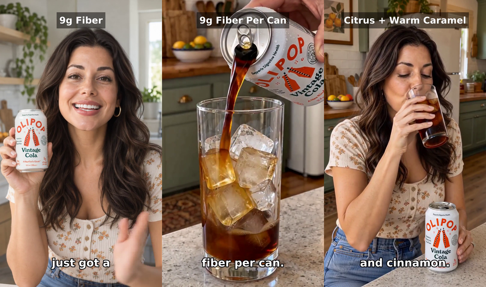
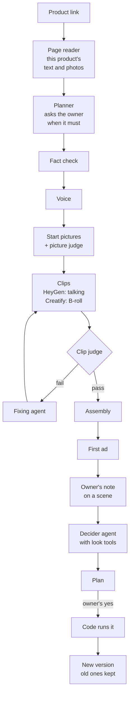

# AdForge

A chat agent that turns a product page into a short video ad. A presenter talks, B-roll shows the product being used, and the shop owner fixes any scene by writing a note.

Watch it work: https://www.loom.com/share/23d2f242ad414ea4ba889d0310d5a38d

See the ads and my grades: https://julian-win-stack.github.io/adforge-gallery/



## How it works



There is no fixed order in code. The producer agent picks these steps as tools and decides what to do next, and every rule that matters lives in a tool that refuses, not in the instructions ([ADR 1](docs/adr/0001-agent-loop-with-safety-in-the-tools.md)). The fixing agent and the decider agent are the other two agents.

One line per box: the problem that made me add it.

- **Page reader.** An ad stated another product's facts, so it keeps only this product's text. ([problem 2](#2-the-ad-stated-another-products-facts-so-i-rebuilt-the-page-reader))
- **Planner.** The model invented uses the page only named, so it asks the owner. ([problem 3](#3-several-actions-in-one-clip-break-the-physics-so-one-clip-is-one-movement), [problem 6](#6-a-one-moment-action-stretched-over-a-five-second-clip))
- **Fact check.** Every claim comes from the page or the owner, checked again after each rewrite.
- **Voice.** Each line is spoken and timed before any clip, so a scene ends after its last word.
- **Start pictures.** Shop photos leaked their scene into clips, so each starts from a drawing. ([problem 5](#5-from-one-drawn-start-picture-to-the-owners-own-pictures-so-notes-steer-the-look))
- **Picture judge.** A drawn phone had screen and camera on one face, so each drawing is checked before paying.
- **Clips.** HeyGen makes the talking clips, Creatify every B-roll clip.
- **Clip judge.** Checks each B-roll clip for a product side it never showed, and motion that can't happen.
- **Fixing agent.** Remakes repeated the fault, so one agent owns a failed scene until the judge passes it or it gives up. ([problem 1](#1-an-ad-cant-be-made-right-in-one-shot-so-a-fixing-agent-owns-the-scene))
- **Assembly.** The mixer cut the last words of every ad, so the voice is padded and the mix ends with the ad.
- **Decider agent.** The note handler couldn't see the picture, so it guessed. The decider looks, then proposes; code runs the plan after my yes. 166 of 170 replayed decisions matched mine.
- **Versions.** A fix can be worse than before, so every try is kept and the owner can go back. ([problem 1](#1-an-ad-cant-be-made-right-in-one-shot-so-a-fixing-agent-owns-the-scene))

**How every judge looks.** Before it answers, it fills in a form of what it sees, in a fixed order (which side faces the camera, which parts are visible, what moved and when), and only then gives a verdict. I use this shape in the picture judge, the clip judge, the fix check and the owner photo check. The one before and after I have is thin: on our one known impossible picture, the plain question caught it 0 of 5 runs, the form 3 of 5, with no new wrong fails on 91 good pictures. One picture, so a design choice more than a proof.

## Hard problems

### 1. An ad can't be made right in one shot, so a fixing agent owns the scene.

- **What broke.** When the judge failed a clip, the app remade it and fed the judge's notes into the video prompt, up to three times. It still failed. A hair tool twist scene cost about $2.50 in remakes and never passed. Remade clips did the banned thing again.
- **Why.** The notes turned into lists of bans, and video models don't follow bans. And every remake kept the same start picture and the same planned action, so the prompt was the only thing that could change.
- **What shipped.** One agent owns the whole scene: action, framing, start picture, prompts, clip length, line and voice.
  - It looks at the frames, writes only positive orders (code refuses ban words), and decides itself when to give up.
  - Up to 6 tries per scene as a money guard. Every try becomes a version the owner can pick.
  - On a give-up after a judge fail, the scene becomes a talking scene.
- **Numbers.** On 10 round-5 cases, 7 passed the judge and I passed 6 (prototype). In the real run every case ended in a judge pass or an honest give-up.
- **Known hole.** The agent trusts the clip judge, and the judge still misses a lot of failures. When the judge passes a bad clip, the agent stops and the bad clip ships. 5 of the 10 cases went wrong that way.

### 2. The ad stated another product's facts, so I rebuilt the page reader.

- **What broke.** A sweatshirt ad described the fit of a pair of sweatpants. The pants were sold in a box on the same page, so the sentence really was on the page, and the fact check let it through.
- **Why.** The reader kept everything on the page, and nothing said which product each part was about.
- **What shipped.** The easy route was to let Firecrawl return every photo and video on the page. But it scrapes the whole HTML, so that list holds every review photo, every cross-sell picture and every useless video on the page. I wanted only this product's, so I tried several ways to filter the page and settled on this one, because it is the only one that ties every sentence and every photo to this product.
  - Firecrawl returns the text, a full-page screenshot with a number on every picture, and the shop's own product record.
  - One model picks this product's photo numbers off the screenshot.
  - A cheap model copies this product's passages word for word, and code drops any sentence not found on the page, so nothing can be invented.
  - Price comes only from the shop's record; if there is none, the planner asks.
- **Numbers.** Other-product sentences: 0 of 102 leaked on 70 pages, run twice, with 87% of useful sentences kept (copy test, 2026-10-02). Another product's photos: 1 of 15 hard pages, against 9 of 15 with the dropped AI filter.

### 3. Several actions in one clip break the physics, so one clip is one movement.

- **What broke.** A hair tool clip asked for clamp, rotate and glide in 7 seconds, and the hair jumped from a flat clamp to a full curl. A toilet cleaner clip asked for squeeze, scrub, wait and flush, and the toilet flushed before the button was pressed.
- **Why.** The video model can't make the change between the actions, so it jumps from the first state to the last and the physics breaks.
- **What shipped.** I tried several ways to let the model handle more than one action and settled on this one, because it is the only rule the model can't bend: one movement per B-roll clip, no exceptions, in the planner, the prompt writer and the fact-check rewrite.
  - The voice carries the other steps.
  - A claim with two end states gets two clips joined by a cut.
  - A finishing step (rinse, flush, dry) never gets its own scene.
- **Numbers.** Plans with 2 or more actions in a B-roll scene went from 18 of 54 to 3 of 56 to 0 of 61 (plan-only checks, 25 products, Claude's count, Oct 8). The 4-step toilet clip failed; the same toilet, scrub only in 5 seconds, I graded perfect (Oct 8).

### 4. Things I couldn't make the video model do yet, and the workaround for each.

This is a model limit or my prompting. I haven't spent much effort on these yet. For now the planner avoids them.

- **Flossing.** I can't make a B-roll clip of someone flossing yet without breaking the physics or adding motion that can't happen.
- **Turning while sliding.** A hair tool has to twist as it glides down the hair. Every try failed, with a different prompt each time. Workaround: none yet. Written down as a limit.
- **Changing from one state to another.** A bag strap went on and off with no real movement in between. Workaround: the planner never films the change itself. It films the before and the after as two clips with a cut. I graded that version perfect.

### 5. From one drawn start picture to the owner's own pictures, so notes steer the look.

- **What broke.** The B-roll API takes either one exact start picture or up to 9 example pictures, never both.
  - The app started every clip from one drawn start picture and described the action. That worked on most ads, but a start picture shows one side of the product, so a clip that turns the product had to invent the other side.
  - I also tried giving the model an end picture of the other side, but lining up a start picture, an end picture and the prompt so the clip passed my grading without breaking the physics was more than I could get right.
  - And when an owner's note came with a reference picture, there was nowhere to put it. The one picture slot was taken by the start picture, and the owner's photo was not a start picture for that scene anyway.
- **Why.** One slot, two needs: the exact starting pose, and the looks only the owner's photos can show.
- **What shipped.** Every B-roll clip now runs in example-picture mode.
  - The drawn start picture goes in as the first example, with the order to start from it, and the owner's pictures come after it. The model doesn't start exactly on that picture, but very close to it, and that turned out to be enough.
  - Before an owner's photo is used, the owner names the one thing in it and code draws a clean copy of only that thing, so the background and other objects don't leak in.
  - This is an architecture change, not a prompt change: one path for every clip, and a place for the owner's pictures.

### 6. A one-moment action stretched over a five-second clip.

- **What broke.** A tablet drop into a bottle takes half a second, but the shortest clip is 5 seconds. The hand held the tablet for 4 seconds, then a tablet appeared in the bottle while one stayed in the hand. In another ad a scoop refilled itself. The one-movement rule from problem 3 didn't catch this, because it was one movement.
- **Why.** A clip is at least 5 seconds at real speed, with one action and a still camera. An action that is over in a moment leaves seconds, and the video model fills them with invented events.
- **What shipped.** I iterated on this a lot and broke things along the way: remake prompts that said what not to do, splitting the moment into two clips, a critic that judged plans and failed many good ones.
  - What I settled on is one planner rule: the one action must last the whole clip by its own course, or show its natural result. Otherwise it becomes a talking scene.
  - It cost one good scene, a one-second swatch. Round 6 is the first run with the rule, so whether it holds is not proven yet.

## Numbers

What a pass means: I watched the finished ad and nothing broke. No wrong claim, no impossible motion, no invented product side, no scene missing. It does not mean the ad would sell. A few of the passes are persuasive. Most are just correct.

- **Whole ads that passed my grading.** Round 4: 7 of 10. Round 5: 8 of 15 new products. Round 6 (2026-10-20): 11 of 15 new products.
  - Of the 4 fails of round 6, 2 ads were never made because the picture step refused every photo on the page, 1 came out as all talking scenes, 1 had B-roll that looked fake.
- **The 7 ads that failed round 5, run again in round 6:** 4 of 7 passed.
- **Clip judge, on round 6 clips it had never seen.** I graded 45 clips the judge had ruled on. We disagreed on 14. It missed 5 clips I failed, 4 of them remakes it had passed. It failed 9 clips I passed.
- **Fixing agent, round 6.** The judge sent it to 18 scenes. 7 came back with a clip I passed, though 4 of those I would have passed before it started. 4 came back with a clip I failed. 4 gave up and became talking scenes. 3 were killed by a worker restart.
- **Owner notes, round 6.** I sent notes on 2 scenes. The first note fixed 1. The other was a talking scene, which a note can't change yet.
- **Picture judge:** caught 6 of 10 kinds of wrong picture, failed 0 of 52 good ones.
- **Fact check:** not measured.

Each part's own number sits in its problem section above.

Every model call the app makes, and what checks it: [docs/decision-map.md](docs/decision-map.md).

### Holes

- One grader, me, and I also built the app.
- The sets are small: 10 to 15 ads a round.
- Round 6 is the first set the current clip judge never saw. Earlier judge numbers are on clips its wording was tuned on.
- The fact check is not measured.

## Limitations and what I'd test next

- Some shops can't be read at all. 12 of 126 pages gave no photos (TikTok Shop, Chewy, Target, Temu). Because of this I built a way in: the owner pastes the page text and photos, and the ad starts from those.
- The clip judge is not perfect yet. It still misses failures and fails good clips, and the fixing agent depends on it, so a judge mistake becomes the agent's mistake.
- The picture judge misses a wrong background object, such as a toilet that isn't a normal toilet (0 of 5).
- With example pictures, the clip judge caught only 1 of the 5 bad phone case clips I failed.
- HeyGen ignores movement text, so an action in a talking scene is a "can't". A photo can't change the presenter either.
- A note can turn a B-roll scene into a talking scene, but not the other way. A talking scene can't become a B-roll scene yet. Easy to build, I ran out of time.
- B-roll quality is not good enough yet. A clip often doesn't show the result the voice claims, such as "94% saw fewer wrinkles".
- In practice it behaves more like a pipeline than it is one. The producer almost always picks the same order, and a note that arrives while a step is running doesn't stop that step, so it finishes and is paid for.
- Round 6 found run problems: with 22 ads in parallel the machine ran out of memory. A step killed mid-run stays "running" forever, and a scene can be marked finished before its judge ends, so only a fresh session recovers. 10 ads needed a fresh restart.
- Also from round 6: a fix plan with no changes never reassembles the ad; page reads hit Firecrawl's rate limit; safety filters refused a makeup sponge picture.

What I'd test next: the fact check. Nobody knows yet whether it actually catches wrong claims or fails silently. The 22 test cases are built and not graded.

## How to run

You need Docker.

```sh
cp .env.example .env      # fill in the keys
docker compose up
```

The app opens at http://localhost:5173 (backend on port 8000).

Keys, by env var name: `OPENAI_API_KEY` (or `AZURE_OPENAI_KEY` and `AZURE_OPENAI_BASE_URL`), `FIRECRAWL_API_KEY`, `INWORLD_API_KEY`, `ELEVENLABS_API_KEY`, `FAL_KEY`, `HEYGEN_API_KEY`, `CREATIFY_API_ID`, `CREATIFY_API_KEY`, `LANGFUSE_PUBLIC_KEY`, `LANGFUSE_SECRET_KEY`.

Tests run on a scripted fake model and need no keys:

```sh
cd backend && uv run pytest -q -n auto
cd frontend && npm test
```
