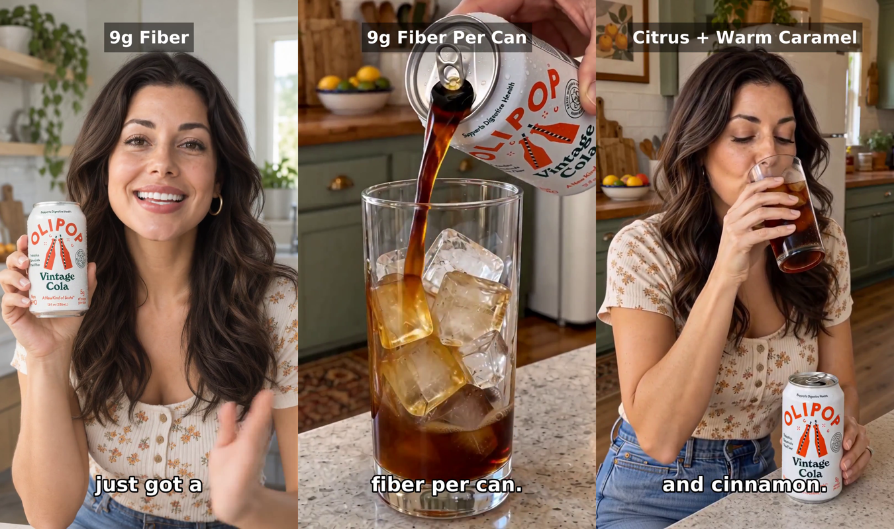
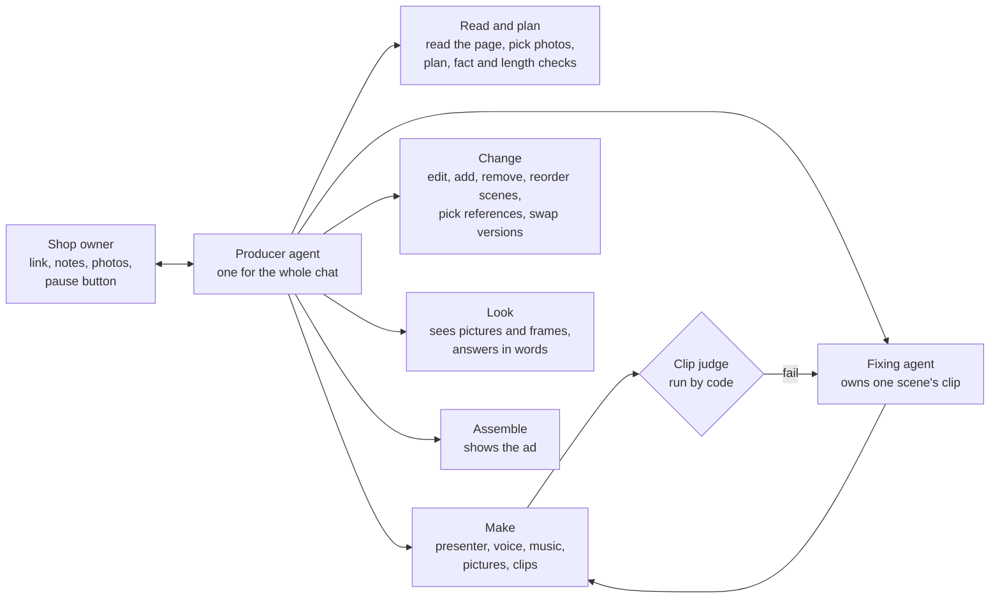

# AdForge

A chat agent that turns a product page into a short video ad. A presenter talks, B-roll shows the product being used, and the shop owner fixes any scene by writing a note.

Watch it work: https://www.loom.com/share/23d2f242ad414ea4ba889d0310d5a38d

See the ads and my grades: https://julian-win-stack.github.io/adforge-gallery/



## How it works

One agent, the producer, runs the whole chat, from the first product link to the last note. It is a model with tools: it calls one, reads the answer, and decides what to do next. There is no pipeline in code. The rules that matter live in the tools, which refuse with a reason ([ADR 1](docs/adr/0001-agent-loop-with-safety-in-the-tools.md), [ADR 10](docs/adr/0010-one-agent-after-the-first-clip.md)).



The producer's tools are in `backend/agents/producer.py`. What the parts do:

- **Reading the page.** Keeps only this product's text and photos. Page videos are watched whole on Gemini and cut into one-action moments for the ad's library. ([problem 2](#2-the-ad-stated-another-products-facts-so-i-rebuilt-the-page-reader))
- **Planning.** Scenes are the presenter talking, or the product shown while the voice goes on. One movement per B-roll clip. ([problem 3](#3-several-actions-in-one-clip-break-the-physics-so-one-clip-is-one-movement), [problem 4](#4-a-one-moment-action-stretched-over-a-five-second-clip))
- **Planning checks.** Every line and what each scene shows is checked against the page, then against how long the scene can last. A line that still fails is asked about. Every fact comes from the page or the owner.
- **Clips.** Each scene's agent films it with Boreal-H3 on Creatify from a checked starting picture. H3 speaks the checked line; the word check and clip judge check it, and the ad cuts each clip half a second after its last word.
- **Look.** The producer can't see. It asks one question about a clip or picture, and a sub-call answers in words. It decides nothing.
- **Clip judge and fixing agent.** Code judges every B-roll clip. On a fail, the fixing agent owns the scene for up to 6 tries. ([problem 1](#1-an-ad-cant-be-made-right-in-one-shot-so-a-fixing-agent-owns-the-scene))
- **Picture judge.** A drawn picture of a part no photo shows is checked before paying.
- **Owner's notes.** The producer looks at the scene first. A note about what a clip shows goes to the fixing agent word for word. Anything else it does itself.
- **Versions.** Every try is kept. The producer or the owner can put any version back.
- **Money and control.** No yes button before paid work. The producer acts, then says what it cost. The pause button cancels steps not started yet; running ones finish.
- **Hard list.** Only three refusals live in code: another product's page mid-ad, a clip of an invented part before the owner approves its picture, and the video API's limits (`backend/agents/hard_list.py`).
- **Assembly.** The voice is padded and the mix ends with the ad, so last words aren't cut.

**Agentic in code, not yet in practice.** The producer's instructions give a usual order for a first ad, and tools refuse steps out of order, so a first ad nearly always runs the same way. The freedom shows mostly on the owner's notes.

**How every judge looks.** Before its verdict, it fills in a form of what it sees in a fixed order (which side faces the camera, which parts are visible, what moved and when). The picture judge, clip judge, fix check and owner photo check all work this way. On our one known impossible picture, the plain question caught it 0 of 5 runs, the form 3 of 5, with no new wrong fails on 91 good pictures. One picture, so a design choice more than a proof.

## Hard problems

### 1. An ad can't be made right in one shot, so a fixing agent owns the scene.

- **What broke.** Remaking a failed clip with the judge's notes in the prompt, up to three times, still failed. Remade clips did the banned thing again.
- **Why.** The notes became ban lists, which video models don't follow, and only the prompt could change.
- **What shipped.** One agent owns the whole scene: action, framing, start picture, prompts, clip length, line and voice. It looks at the frames and decides when to give up. Up to 6 tries per scene; every try is a version the owner can pick.
- **Numbers.** On 10 round-5 cases, 7 passed the judge and I passed 6.
- **Known hole.** The agent trusts the clip judge. When the judge passes a bad clip, the bad clip ships (5 of the 10 cases).

### 2. The ad stated another product's facts, so I rebuilt the page reader.

- **What broke.** A sweatshirt ad described the fit of sweatpants sold in a bundle on the same page. The sentence really was on the page, so the fact check let it through.
- **What shipped.** Firecrawl returns the text, a full-page screenshot with a number on every picture, and the shop's own product record.
  - One model picks this product's photo numbers off the screenshot.
  - A cheap model copies this product's passages word for word, and code drops any sentence not found on the page.
  - Price comes only from the shop's record; if there is none, the planner asks.
- **Numbers.** Other-product sentences: 0 of 102 leaked on 70 pages, with 87% of useful sentences kept. Other-product photos: 1 of 15 hard pages, against 9 of 15 with the dropped AI filter.

### 3. Several actions in one clip break the physics, so one clip is one movement.

- **What broke.** A toilet cleaner clip asked for squeeze, scrub, wait and flush, and the toilet flushed before the button was pressed.
- **Why.** The video model can't make the change between actions, so it jumps from the first state to the last.
- **What shipped.** One movement per B-roll clip, no exceptions, in the planner, the prompt writer and the fact-check rewrite. The voice carries the other steps. A claim with two end states gets two clips joined by a cut. A finishing step (rinse, flush, dry) never gets its own scene.
- **Numbers.** Plans with 2 or more actions in a B-roll scene went from 18 of 54 to 0 of 61 (25 products). The same toilet, scrub only, I graded perfect.

### 4. A one-moment action stretched over a five-second clip.

- **What broke.** A clip is at least 5 seconds, so a half-second action (a tablet dropped into a bottle) leaves seconds empty, and the model fills them with invented events.
- **What shipped.** One planner rule: the action must last the whole clip by its own course, or show its natural result. Otherwise it becomes a talking scene. Dropped along the way: ban-list remake prompts, splitting the moment into two clips, and a plan critic that failed good plans.

### 5. Things the video model can't do yet.

The planner avoids them.

- **Flossing.** No clip yet without broken physics.
- **Turning while sliding** (a hair tool twisting as it glides). Every try failed. No workaround.
- **Changing from one state to another** (a strap going on). The planner films the before and the after as two clips with a cut. I graded that perfect.

### 6. One picture slot, two needs: the starting pose and the owner's photos.

- **What broke.** H3 takes one start picture or up to 9 example pictures, never both. A start picture shows one side of the product, and an owner's photo sent with a note had nowhere to go.
- **Tried and dropped.** Example pictures for every clip, then page photos with no drawn start picture (round 7). The model redrew the product and copied backgrounds.
- **What ships.** Every clip is filmed from a drawn starting picture that passed its check (`backend/agents/scene_agent/film.py:Film`, [ADR 11](docs/adr/0011-one-agent-per-broll-scene.md)). An owner's photo sent with a note must reach that scene's agent (`backend/agents/note_photos.py`). A part no photo shows gets its own picture, which the owner approves before any clip (`backend/jobs/owner_parts.py`).

## Numbers

A pass means I watched the finished ad and nothing broke: no wrong claim, no impossible motion, no invented product side, no missing scene. It does not mean the ad would sell. A round is one batch of ads from real product pages after a set of changes, graded by me.

The numbers below are from round 6 (2026-10-20). Every later round is in [docs/test-rounds/README.md](docs/test-rounds/README.md).

- **Ads.** 11 of 15 new products passed in round 6, up from 8 of 15 in round 5. 4 of the 7 round-5 fails passed on a rerun.
- **The clip judge is the weak spot.** On 45 unseen clips it passed 5 I failed and failed 9 I passed.
- **The fixing agent helps less than it looks.** Of 18 scenes, 7 came back with a clip I passed (4 of those were fine already), 4 with a clip I failed, 4 gave up, 3 were cut off by a restart.
- **The picture judge** caught 6 of 10 kinds of wrong picture and failed 0 of 52 good ones.
- **The fact check** is not measured.

Current scene generation and checks: [ADR 0012](docs/adr/0012-every-scene-made-with-h3.md).
The [historical model-call map](docs/adr/0012-legacy/decision-map.md) records the retired paths.

### Holes

- One grader, me, and I also built the app.
- Small sets: 10 to 15 ads a round.

## Limitations and what I'd test next

- The clip judge still misses failures and fails good clips, and the fixing agent depends on it.
- The picture judge misses a wrong background object (0 of 5).
- B-roll often doesn't show the result the voice claims, such as "94% saw fewer wrinkles".
- A note sent while a step is running doesn't stop that step. Only the pause button cancels steps not started yet.
- A scene can be marked finished before its judge ends. A worker restart fails steps left running (`backend/agents/tasks.py:carry_on_after_the_worker_starts`).
- Some shops can't be read (TikTok Shop, Chewy, Target, Temu). The owner can paste the page text and photos instead.

Next to test: whether the fact check catches wrong claims. The 22 test cases are built and not graded.

## How to run

You need Docker.

```sh
cp .env.example .env      # fill in the keys
docker compose up
```

The app opens at http://localhost:5173 (backend on port 8000).

Keys, by env var name: `OPENAI_API_KEY` (or `AZUREE_OPENAI_KEY` and `AZUREE_OPENAI_BASE_URL`), `FIRECRAWL_API_KEY`, `ELEVENLABS_API_KEY`, `FAL_KEY`, `GEMINI_API_KEY`, `CREATIFY_API_ID`, `CREATIFY_API_KEY`, `LANGFUSE_PUBLIC_KEY`, `LANGFUSE_SECRET_KEY`.

Tests run on a scripted fake model and need no keys:

```sh
cd backend && uv run pytest -q -n auto --dist worksteal -m "not slow"   # fast run, ~30 s
cd backend && uv run pytest -q -n auto --dist worksteal                  # everything, as CI
cd frontend && npm test
```
