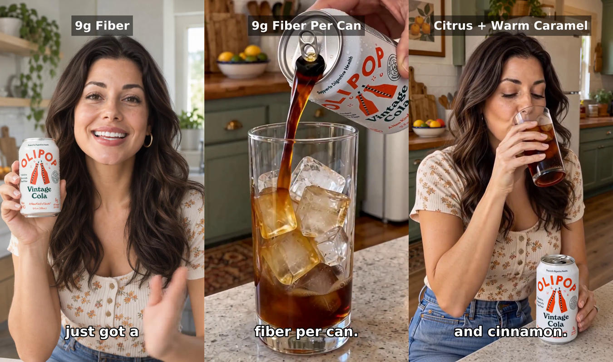

# AdForge

A chat agent that turns a product page into a short video ad. You send a product link and it makes the whole ad: a presenter talks about the product, and product shots show it being used. If a scene comes out wrong, you write a note in the chat and the agent fixes it.

- **The ads, a month ago and now:** _link coming_
- **Loom walkthrough:** [_link ](https://www.loom.com/share/e71fc00b292e4eda901238046fbb9be5) 
- **Try it:** the live link and login are in the message that came with this. They're not here because this repo is public.



## Words I use

- **Video model:** the AI that films each clip. It's Boreal-H3, Creatify's model (H3 for short).
- **Clip:** one scene of the ad, filmed by the video model. An ad is 3 or 4 clips.
- **Product shot:** a clip that shows the product being used, with the presenter's voice over it. The code calls it B-roll.
- **Agent:** an AI model that calls tools in a loop and decides what to do next.
- **Main agent:** the one agent the user chats with. The code calls it the producer.
- **Scene agent:** one agent per scene. It draws the clip's starting picture, films the clip and fixes it.
- **Starting and end pictures:** pictures drawn by a picture model before filming. The video model starts the clip from the starting picture, and ends exactly on the end picture.
- **Clip judge:** an AI check that watches each clip after it's filmed.
- **Round:** one batch of ads from real product pages after a set of changes, graded by me.

## How it works

<picture>
  <source media="(prefers-color-scheme: dark)" srcset="docs/readme/how-it-works-dark.png">
  
</picture>

<!-- The diagram is a picture so its labels show whole on every screen. Source: docs/readme/how-it-works.mmd; render it with Mermaid in light and dark and replace both PNGs. -->

Why the main parts are like this:

| Part | Why it's like this |
|---|---|
| Main agent | [How the architecture got here](docs/why/architecture.md): every change, and the failure behind it |
| Read and plan | [Reading the page](docs/why/read-the-page.md): an ad once said another product's facts |
| Scene agent | [Working around the video model](docs/why/video-model.md): starting pictures, end pictures, one movement per clip |
| Checks | [Getting the clip judge to agree with me](docs/why/clip-judge.md): what the judge should fail |

Every part, with its code: [docs/how-it-works.md](docs/how-it-works.md).

## The hard parts

### 1. Working around the video model

AI video still breaks physics a lot. That's normal right now, so most of my work went into finding what it does wrong and building around it.

- **The biggest one:** a drawn and checked starting picture for every clip. In round 7 I sent the real page photos instead, and the video model copied everything in them: backgrounds, clothes, other people. 14 of 27 product shots worked. With checked starting pictures in round 8, 26 of 27.
- **The rest:** end pictures, one movement per clip, contents never changing on screen, and the whole product in the starting picture: [docs/why/video-model.md](docs/why/video-model.md). All 21 quirks I found: [docs/h3-limits.md](docs/h3-limits.md).
- **Ask me about:** why a drawn picture works better than the real product photos.

### 2. Getting the clip judge to agree with me

- **Three paths:** strict, fail every flaw. Lenient, fail only what it can catch reliably. The middle, fail only what a viewer would notice.
- The middle is what I really want, but judging videos is mostly about taste, and I still can't align the judge with me there.
- **What I chose:** lenient in the app, and the user fixes the rest with a note. In my two tests, one note fixed 16 of 22 bad scenes. More: [docs/why/clip-judge.md](docs/why/clip-judge.md).
- **Ask me about:** why I stopped chasing a perfect judge.

### 3. Why an AI eval judge doesn't pay off for me

- Since I started building, I kept working on an AI judge that grades every ad after I change the app, so I'd only look at what it flags.
- On the Nov 17 run it caught 3 of my 11 failed clips. Most of the ones it missed were hands or bodies breaking physics.
- At 15 to 30 ads a run, my eyes plus my saved grades are faster and better. So the test answered no, for my case. More: [docs/why/evals.md](docs/why/evals.md).
- **Ask me about:** when an eval judge would pay off.

## How the architecture got here

Every change came from a failure I graded. The full story: [docs/why/architecture.md](docs/why/architecture.md).

1. **Decider (Oct 16), removed now.** A second agent looked at the clip before fixing a user's note, because fixing from the words alone fixed the wrong thing.
2. **Fixing agent (Oct 19), removed now.** An agent looked at a failed clip and changed the action or picture, because filming again with "don't do X" brought the same mistake back.
3. **Today: one main agent, plus one agent per scene.** One agent that can act on anything the user asks (Oct 29), because rules in code had dead ends and refused what the user asked. And one agent per scene that sees its own pictures (Nov 3), because round 7 failed mostly from pictures picked by an AI that never saw them.

## Numbers

My last graded test, Nov 17: 30 ads, 15 on my fixed test products and 15 on products I never tested before.

- **Whole ads:** 21 of 30 worked. One bad clip fails the whole ad.
- **Clips:** 105 of 116 clips in the final ads worked.
- **Fixing with a note:** one note fixed 16 of 22 bad scenes, across two tests on Nov 17 and 18 ([tests](docs/test-rounds/scene-tests.md#owner-note-eval-nov-17-ads)).

AI video still breaks sometimes, so the app is built around fixing it with a note.

"Worked" means I watched it and nothing broke: no wrong claim, no impossible motion, no made-up product part. It doesn't mean the ad would sell. I didn't grade that. Every round, with every failure and its fix: [docs/test-rounds/README.md](docs/test-rounds/README.md).

## What it still can't do

- **End pictures.** They mostly work, but sometimes they make faults. The video model always tries to end exactly on the end picture, so if the end picture is wrong, or doesn't match what the prompt asks, the clip goes wrong. And even when the agent asks for the right thing, the picture model sometimes draws the wrong thing. About 3 to 6 of 24 failed clips across 4 runs trace back to them. I can definitely fix this, but I chose not to right now, because most of the time they do more good than harm.
- **Logos and labels.** Wrong letters are fine to me. But sometimes a logo comes and goes, in a different colour and place from the real one (a Stanley cup ad).
- **Still shots.** We still haven't figured out how to do still shots properly. With nothing to move, the video model moves something by itself, like a drawer or a sprayer.

## What I'd work on next

- **Make the ads pull.** Make them sell, not just work. This needs domain knowledge.
- **New products, new failures.** Test the agent on new products, find the new ways it fails and fix them. This is quite manual.
- **How far the agents can go.** The app can do more than make an ad and fix it with notes. I didn't test the rest, because making ads and fixing them with notes is the scope right now ([#549](https://github.com/Julian-Win-Stack/adforge/issues/549)).

## How to run

You need Docker.

```sh
cp .env.example .env      # fill in the keys
docker compose up
```

The app opens at http://localhost:5173 (backend on port 8000).

Keys, by env var name (what each is for is in `.env.example`):

- `OPENAI_API_KEY`: pictures, and every model call when Azure isn't set.
- `AZUREE_OPENAI_KEY` and `AZUREE_OPENAI_BASE_URL` (optional): run the text and vision models on Azure.
- `GEMINI_API_KEY`: watches page videos and videos the user sends. It isn't in `.env.example`; add it yourself.
- `FIRECRAWL_API_KEY` (page reading), `ELEVENLABS_API_KEY` (transcripts), `FAL_KEY` (music, picture hosting), `CREATIFY_API_ID` and `CREATIFY_API_KEY` (H3 clips).
- `LANGFUSE_PUBLIC_KEY` and `LANGFUSE_SECRET_KEY` (traces), `SENTRY_DSN` (optional, failure alerts).

Tests run on a scripted fake model and need no keys:

```sh
cd backend && uv run pytest -q -n auto --dist worksteal -m "not slow"   # fast run, ~30 s
cd backend && uv run pytest -q -n auto --dist worksteal                  # everything, as CI
cd frontend && npm test
```
