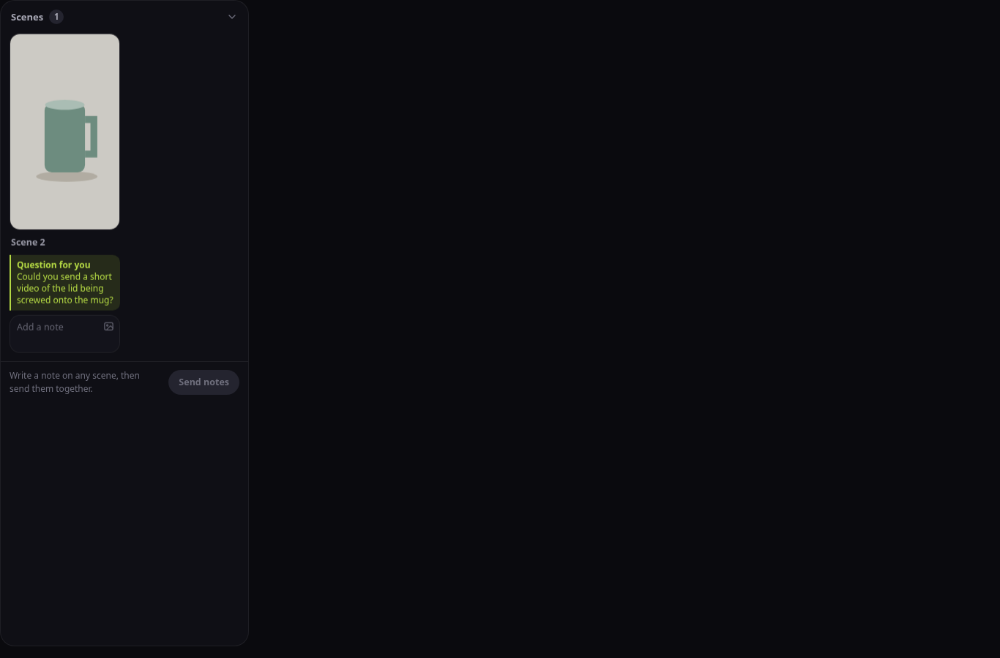
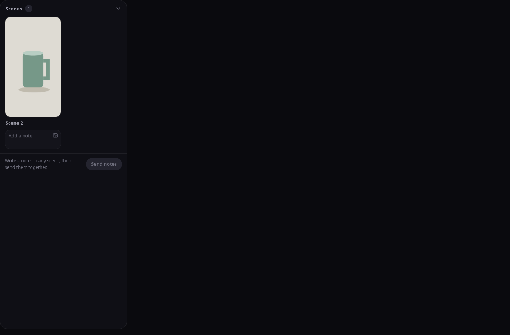

# Scene card without owner questions

The screenshots use the actual `ScenePanel` React component and app stylesheet in local Vite. Both show the same synthetic fixture: a drawn mug starting picture and a legacy open question for scene 2. No backend, paid service or owner data was used.

Captured with Chromium through Playwright at 1366 × 900, device scale factor 1. The temporary fixture was removed after capture. The after check also asserted that no note named “Question for you” existed; the scene's note box remains available.

| Before | After |
| --- | --- |
|  |  |

The frontend suite passed all 211 tests, plus formatting, lint and the TypeScript/Vite build.
